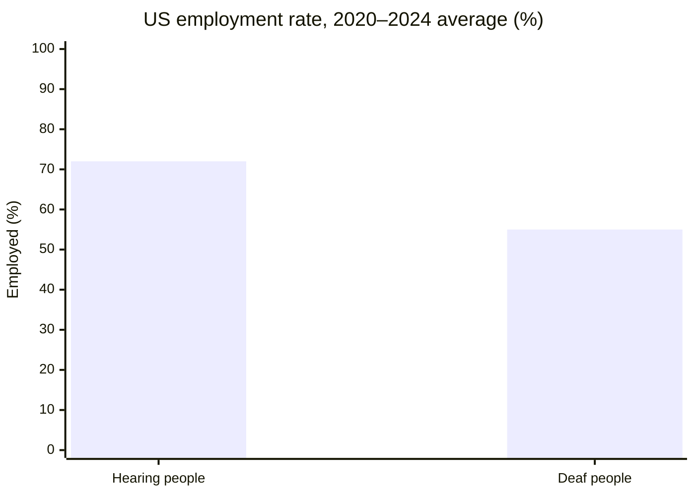
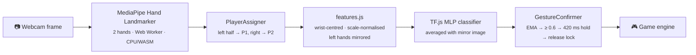

<div align="center">

# ✦ CelestiSign

**A two-player ASL fingerspelling game. Your hands are the controllers.**

Asteroids carrying letters fall toward each player's base. Sign the letter in American Sign
Language to blast them. One webcam, two players, no controllers, all in the browser.


[Why it matters](#-why-it-matters) ·
[Quick start](#-quick-start) ·
[How to play](#-how-to-play) ·
[Game modes](#-game-modes) ·
[Power-ups](#-power-ups) ·
[How it works](#-how-it-works) ·
[Development](#-development)

</div>

---

## ✨ Highlights

| | |
|---|---|
| 🖐️ **Hands are the controller** | MediaPipe tracks both players' hands from one webcam. A custom classifier reads the ASL letter each hand is making. |
| ⚔️ **Two ways to play** | **Versus:** a fair duel where both players get the same asteroid stream. **Co-op Boss:** team up against *THE SILENCER*. |
| 🧑‍🏫 **Learn as you play** | The practice round has a **3D pose coach**: a ghost hand shows the target letter and each of your fingers turns green, amber or red. |
| 🙌 **Hands-free menus** | Every button has an ASL letter badge. Hold the pose and it fires, so you never need to touch the keyboard. |
| 🎵 **Musical combos** | Destroyed asteroids play notes over a D-major progression, so both players always harmonise. A combo streak becomes a melody. |
| 💻 **Runs on any laptop** | Everything runs on the CPU in the browser. Hand tracking runs in a Web Worker, so rendering stays smooth. |

**Letters in play:** `B` `C` `F` `H` `I` `K` `L` `N` `O` `Q` `V` `W` `X` `Y`
(the 14 letters the classifier recognises most reliably on datasets it was never trained on).

---

## 💙 Why it matters

Deafness is common. What deaf people struggle with is less the hearing itself than the people
around them who can't sign.

| | |
|---|---|
| 🌍 **430 million** | people worldwide need rehabilitation for disabling hearing loss, over 5% of the world's population. By **2050**, nearly **2.5 billion** people are expected to have some degree of hearing loss.<sup>[1]</sup> |
| 🤟 **70 million+** | deaf people use **more than 300** different sign languages. Over 80% of them live in developing countries.<sup>[2]</sup> |
| 👪 **More than 90%** | of deaf children are born to **hearing parents**,<sup>[3]</sup> most of whom have no prior knowledge of a sign language.<sup>[4]</sup> For many deaf children, the communication gap starts at home. |
| 💼 **55% vs 72%** | of deaf vs hearing people in the US were employed, on average, in 2020–2024.<sup>[5]</sup> |
| 🏥 **48.5%** | of deaf participants in one district study in Ghana reported a misdiagnosis caused by communication barriers, and 44.3% avoided healthcare altogether.<sup>[6]</sup> |



### People want to learn, and games help

- **American Sign Language is the 3rd most-studied language at US colleges**, behind only
  Spanish and French, with 107,899 enrollments in fall 2021.<sup>[7]</sup>
- **Games make learners more motivated.** A meta-analysis of experimental studies found a
  moderate positive effect of gamification on learner motivation (Hedges' *g* = 0.54).<sup>[8]</sup>
- **Recognition games are already being used to teach sign language.** *PopSign*, built by
  RIT/NTID, Google and Georgia Tech, is a bubble-shooter that helps hearing parents of deaf
  children learn ASL. In a 20-person study, having novices *produce* signs in the game was
  more efficient for building ASL skills than a recognition-only version.<sup>[9]</sup>

CelestiSign is built on the same idea: **you learn a letter by signing it**, with a coach that
shows exactly which finger to fix, and a friend next to you to make it fun. Fingerspelling is
only a small first step into a full language, but it's a step anyone can take with a laptop and
a webcam.

> **A note on words.** Prefer *Deaf* and *hard of hearing*. Terms like "deaf-mute" or "deaf and
> dumb" are outdated and considered offensive. Many deaf people use their voice, and sign
> languages are complete languages with their own grammar.

<details>
<summary><b>📚 Sources</b></summary>
<br>

1. World Health Organization, [*Deafness and hearing loss* fact sheet](https://www.who.int/news-room/fact-sheets/detail/deafness-and-hearing-loss) (3 March 2026).
2. United Nations, [International Day of Sign Languages](https://www.un.org/en/observances/sign-languages-day), citing the World Federation of the Deaf.
3. NIDCD (US National Institutes of Health), [Quick Statistics About Hearing](https://www.nidcd.nih.gov/health/statistics/quick-statistics-hearing).
4. [*Hearing parents learning sign language: a call for systemic changes*](https://cnlse.es/es/recursos/biblioteca/hearing-parents-learning-sign-language-a-call-for-systemic-changes), *Journal of Deaf Studies and Deaf Education* (2026).
5. National Deaf Center data (US Census Bureau ACS), reported in [*For Deaf Workers, A Long Road To Closing An Employment Gap*](https://www.disabilityscoop.com/2026/07/07/for-deaf-workers-a-long-road-to-closing-an-employment-gap/32073/), Disability Scoop (July 2026).
6. Cross-sectional study of 167 deaf people and 20 healthcare providers in one Ghanaian district, [AAMUSTED repository](https://ir.aamusted.edu.gh/handle/123456789/523). A single small study, so it shouldn't be read as a global rate.
7. Modern Language Association, *Enrollments in Languages Other Than English in US Institutions of Higher Education, Fall 2021*, summarised on [Wikipedia](https://en.wikipedia.org/wiki/List_of_most_commonly_learned_second_languages_in_the_United_States).
8. [*The Effect of Gamification on Learner Motivation: A Meta-Analysis Study*](https://www.ceeol.com/search/article-detail?id=1084268) (2022).
9. [*PopSignAI: Towards Using Sign Language Recognition Games to Improve American Sign Language Learning in Novice Signers*](https://cnlse.es/es/recursos/biblioteca/popsignai-towards-using-sign-language-recognition-games-to-improve-american-sign-language-learning-in-novice-signers) (IUI 2026); [RIT news on PopSign](https://www.rit.edu/news/parents-deaf-children-can-more-easily-learn-sign-language-thanks-powerful-tech-collaboration).

</details>

---

## 🚀 Quick start

> **Requirements:** Node.js 20.19+ or 22.12+ (for Vite 8), a webcam, and a modern Chromium, Firefox or Safari browser.

```bash
cd web
npm install    # also copies the MediaPipe WASM runtime + hand model into public/
npm run dev    # → https://localhost:5173  (or https://<your-ip>:5173 from another device)
```

The dev server uses a **self-signed certificate** because browsers only allow webcam access on
secure pages. Accept the warning once.

| Command | What it does |
|---|---|
| `npm run dev` | Dev server over HTTPS, reachable on your LAN |
| `npm test` | Unit tests: classifier parity with Python, gesture logic, game engine, boss, pose coach |
| `npm run build` | Static site in `web/dist/` with relative paths. Host it anywhere over HTTPS. |
| `npm run preview` | Serves the production build (includes the optional Gemini taunt endpoint) |

The classifier (`web/public/models/asl_tfjs/`) is **already trained**. You only need
[`training/`](training/README.md) if you want to retrain it.

---

## 🎮 How to play

1. **Stand side by side** in front of one webcam. **Player 1 is the hand on the left of the
   screen, Player 2 the hand on the right.** Either hand works. The game detects whether it's a
   left or right hand and shows the matching pose hints.
2. **Camera setup.** A live view shows each player's tracked hand and predicted letter. Both
   players hold a flat **B** to start practice, or anyone holds **Y** to skip straight to the game.
3. **Practice round.** Each player signs four letters on stationary asteroids, at their own pace,
   with the [pose coach](#pose-coach) helping.
4. **3‑2‑1‑GO!** In Versus, the **last player with health remaining wins**. In Co-op, the team
   wins by **defeating the boss**.
5. **Results** show score, kills, bubbles, accuracy, best combo and hits taken. For a rematch,
   both players hold **B** (or press <kbd>Enter</kbd>).

### Signing a letter

- Make the pose shown on your target and **hold it** until the ring around your letter fills
  (about **0.4 s**). The ring only fills while the smoothed confidence is at least **0.6**.
- Your turret fires a beam at **every** target on your side that needs that letter.
- To use the **same letter again**, relax your hand briefly first. The ring turns white and
  says "relax to repeat" until you do. A different letter counts immediately.
- The bottom panel always shows what the camera thinks you're signing and the **next letter
  you need**, with a pose diagram and a one-line hint.

### Hands-free menus

Hand tracking starts as soon as the page loads, so every menu can be driven by handshapes.
Each button has a badge with its ASL pose. Hold the pose until the badge's ring fills. A legend
bar at the bottom lists the poses available on the current screen.

| Pose | Means | Where |
|:---:|---|---|
| **B** (flat hand) | confirm / go | Start · Practice ×2 · Resume · Rematch ×2 · Try again |
| **L** | leave | Back · Main menu |
| **Y** | skip | Skip to game · Restart match |
| **V** / **C** | Versus / Co-op | Start screen |
| **O** / **X** | toggle shared orbs / shared targets | Start screen (Co-op) |
| **K** | keyboard mode | Camera error screen |

Buttons marked **×2** need **both** players to hold the pose. Navigation letters only count on
menu screens and never interfere with gameplay.

<a id="pose-coach"></a>
<details>
<summary><b>🧑‍🏫 The practice pose coach</b></summary>
<br>

For players who don't know the alphabet yet, practice shows:

- step-by-step instructions for the letter
- a **three.js 3D view** of the target handshape (a translucent "ghost" hand) with the player's
  own tracked hand overlaid live. Each finger turns **green** (matches), **amber** (nearly) or
  **red** (adjust). The view sways to show depth and can be dragged to rotate.
- a **match meter**: the classifier's live probability for the target letter
- plain feedback, such as *"Adjust: thumb, index"* or *"Fingers look right – turn your hand to
  match the ghost"*

Finger checks compare the two outer joints of each finger with a reference pose. Each finger's
tolerance is learned from how much real signers vary (`hand_poses.json`). three.js is only
loaded when practice starts. Without WebGL, the coach falls back to the steps and a 2D diagram.

</details>

---

## ⚔️ Game modes

### Versus

Both players receive the **identical asteroid stream** from the same random seed, so the
outcome depends only on skill and on power-ups.

<details>
<summary><b>📜 Full rules: targeting, scoring, difficulty</b></summary>
<br>

**Asteroids**
- Each asteroid shows its letter in the centre. **Sequence asteroids** (from level 2) show a row
  of letter chips that must be signed **in order**. The current letter is white and finished
  letters are ticked.

**Targeting**
- A confirmed letter hits **every** asteroid, orb or shield node on *your* side whose next
  required letter matches. Single-letter targets are destroyed. Sequences advance one step.
- Two or more kills from one sign show **MULTI ×N** and add a bonus of 100 per extra kill.
  For accuracy, one sign still counts as one letter.
- Hits resolve most urgent first (least time left), then the older object.
- With no pose held, rotating brackets mark the most urgent target. While you hold a pose,
  **every** target it will hit is locked on: brighter brackets, your progress, a dashed aim
  line from your turret and an ×N tag.

**Misses and damage**
- A letter that matches nothing is a **miss** and resets your combo.
- An impact costs **12 HP**, plus **6** for each unfinished letter on a sequence asteroid, and
  resets your combo.

**Score**
- 100 per letter for a destroyed asteroid, 300 for a bubble, 25 for a partial hit
- Combo multiplier: ×1.25 every 3 kills, up to ×3

**Difficulty** rises every 22 s, up to level 12:

| | Level 1 | Max level |
|---|---|---|
| Spawn interval | 3.0 s | 1.05 s |
| Time to cross the field | 10.5 s | 5.2 s |
| On screen at once | 3 | 7 |
| Sequence length | 1 letter | up to 4 (from level 6) |

</details>

### Co-op Boss: *THE SILENCER*

On the start screen, choose **Co-op Boss** to team up against an all-seeing eye that drowns out
communication. Setup, practice and controls are the same as in Versus.

- **Shared team health (150).** Asteroids hitting either base drain the team pool.
- **Every kill hurts the boss.** Each destroyed asteroid fires a bolt worth 10 damage per
  letter, times your combo multiplier. Orbs add 20. The results screen names an **MVP**.
- **Core link (the main co-op mechanic).** The boss opens its core and shows a four-letter
  chain whose letters **alternate between players** (P2 → P1 → P2 → P1). Sign them in turn
  before the ring runs out to deal **150 damage** and stun the boss for 3 s.
- **Phases and shields.** At 66% and 33% health the boss changes colour, gains new attacks and
  drops a **shield node on each side**. It's immune until **both** players break their node.
- **It talks.** The boss taunts the players in a typed-out speech bubble, optionally written
  live by Gemini ([setup](#optional-live-boss-taunts-gemini)).

<details>
<summary><b>👁️ Boss attacks, scaling and co-op options</b></summary>
<br>

**Telegraphed attacks.** About 1.3 s ahead, the eye charges and a warning appears over the
target side:

| Attack | Effect | From |
|---|---|---|
| **Volley** | Rocks on both sides | Phase 1 |
| **Meteor** | One big 3–4-letter rock on one side | Phase 1 |
| **Barrage** | Three fast singles on one side | Phase 2 |
| **Curse** | Slows one player for 4 s | Phase 2 |

**Health and scaling.** The boss has **4,500 HP**. Difficulty rises **continuously** as it
weakens, rather than in steps at phase changes. From full health to nearly dead:

| | Full health | Nearly dead |
|---|---|---|
| Asteroid difficulty level | 2 | 8 |
| Gap between boss attacks | 6.5 s | 3.8 s |
| Core link interval | 20 s | 13 s |
| Time to finish a core link | 11 s | 8.5 s |

If a shield node expires, the boss regenerates 8% of its health, capped at that phase's
threshold. While the core is open, a letter that matches your turn advances the chain **and**
still blasts every matching asteroid.

**Co-op options** (start screen toggles, remembered between sessions, shown on the boss HUD):

- **Shared power-ups** *(on by default)*: Shield, Freeze, Haste, Reflect and Nova apply to
  **both** players, whoever clears the orb. Nova clears both sides and credits each player for
  their own side. Turned off, these orbs only help the player who cleared them.
- **Shared targets** *(off by default)*: either player can shoot anything on either side, and
  the beam crosses the divider.
  - A sign hits every matching target on **both** sides, most urgent first (ties: your own
    side, then the older object). The shooter gets the score and boss damage.
  - Asteroids spawn about twice as often (0.8× the versus interval instead of 1.6×), and two
    more fit on screen per side.
  - A letter whose target your teammate just cleared doesn't break your combo.
  - Each side gets its own random stream. When a new target's first letter is already in play,
    it's re-rolled once with 60% probability (`DUPLICATE_REROLL` in `web/src/game/words.js`).
    That gives about a third fewer duplicates, while still allowing multi-kills.

**Orbs in co-op:**

| Orb | In boss mode |
|---|---|
| Attack | Hits the boss for 60 |
| Slow | Slows the boss's attack timer |
| Leech | 40 to the boss, +12 to the team |
| Heal | +20 to the team |
| Reflect | The next boss attack on each side becomes 50 damage to the boss |
| Shield, Freeze, Nova, Haste | Applied to both players when shared power-ups is on |

**Win and lose.** **VICTORY** when the boss reaches 0 HP, after a chain of explosions.
**DEFEAT** if the team pool empties.

All numbers live in `BOSS` in `web/src/game/boss.js` and are unit-tested in
`web/test/boss.test.js`.

</details>

---

## 🫧 Power-ups

Bubbles appear from about 26 s onward, roughly every 11–18 s per side. They float in the upper
field and need **3–4 letters** before their deadline ring runs out (7.5–10 s). If the deadline
passes, they escape harmlessly. Each bubble's effect is picked when it spawns, from the effects
allowed at that moment, so cooldowns and grace periods always hold.

| Orb | Look | Effect | Balance |
|---|---|---|---|
| 🎯 **Attack** | red crosshair | 2–4 extra asteroids drop on the opponent after a 1.4 s warning | 16 s cooldown · victim gets 10 s grace |
| ⏳ **Slow** | violet hourglass | Opponent's ring fills at **half speed** for 6 s | 16 s cooldown · 10 s grace after it ends |
| 🛡️ **Shield** | gold hexagon | A dome absorbs the next impact (expires after 25 s) | Not offered while active |
| ➕ **Heal** | green plus | +20 HP (max 100) | More common below 50 HP · never at full health |
| ❄️ **Freeze** | ice-blue snowflake | Everything on **your** side pauses for 4 s, and you can still shoot | 14 s cooldown |
| 💥 **Nova** | orange starburst | Detonates every asteroid on **your** side (half points each) | 20 s cooldown · more common when crowded |
| ⚡ **Haste** | lime bolt | Your ring fills **1.6× faster** for 7 s (Haste + Slow = 0.8×) | 16 s cooldown |
| 🪞 **Reflect** | prismatic mirror | The next Attack, Slow or Leech aimed at you **bounces back** (15 s) | Not offered while active |
| 🩸 **Leech** | crimson droplet | Steals 12 HP from the opponent (never below 1) | 18 s cooldown · 10 s grace · opponent must have > 25 HP |

<details>
<summary><b>🎆 What breaking an orb looks like</b></summary>
<br>

1. **The break:** a short hit-stop (game time nearly freezes for ~0.1 s), a zoom punch, glass
   shards, light rays, a colour flash over that half, and a shatter sound.
2. **The flight:** the orb's icon flies to whoever it affects. A reflected orb visibly hits the
   barrier and bounces back.
3. **The landing:** a sub-bass hit, a big banner (e.g. *"LEECH → Player 2 · 12 HP stolen"*), and
   an orb-specific finisher: a Nova shockwave, frost cracks, a healing light column, speed
   streaks, slow ripples, a red alarm border, prism arcs, or a leech beam carrying health
   between the bases.

Reduced-motion mode drops the hit-stop, zoom, flash and rays.

</details>

---

## 🧠 How it works



### The classifier

A small MLP on **hand landmarks**, not images, so it's tiny and fast enough to run every frame
for both hands. It was trained in TensorFlow/Keras and runs in the browser with TensorFlow.js.

| | |
|---|---|
| **Data** | 3,864 static-letter samples from three public datasets (ASLNow! landmarks + two photo sets run through MediaPipe, each photo also flipped for real left-hand data) |
| **Model** | 118 features → 128 → 128 → 64 → 24 classes · 41,560 parameters · picked by a 16-configuration hyperparameter search |
| **Accuracy (5-fold CV)** | **96.4%** |
| **Accuracy on an unseen dataset** | **86.6%** (nested estimate) |
| **The 14 game letters** | **0.94** average F1 on unseen datasets |
| **Not included** | **J** and **Z**, which are motion letters |

Full methodology, per-letter results and the left-vs-right hand analysis are in
[`training/README.md`](training/README.md) and
[`training/reports/evaluation.md`](training/reports/evaluation.md).

<details>
<summary><b>🔍 Recognition details: players, handedness, failure handling</b></summary>
<br>

- **Player assignment goes by screen side, not by hand.** With two hands, the left-most is P1.
  A single hand goes to the half it's in, but near the midline it keeps its current player so
  it doesn't flicker. A player keeps their slot for 1.2 s after their hand vanishes, and
  duplicate detections are merged.
- **Handedness** (MediaPipe's label on the raw, un-mirrored frame) is used to mirror left hands
  before classification and to show the right guide cards and 3D coach. The *Swap left/right
  detection* checkbox fixes cameras that mirror in the driver. It only affects hints, never
  who is Player 1.
- **Missing hands:** after 0.7 s your half shows *"Player N: raise your hand"*. After 3.5 s the
  match auto-pauses and resumes when both hands are back. Hiding the tab also pauses.
- **Low confidence:** the ring stays empty and shows *"unsure – hold steady"*. Nothing ever
  fires below the threshold.
- **Camera errors** (denied, not found, in use, insecure page, model failure) each get a
  specific message, a retry button and a keyboard-mode fallback.

</details>

<details>
<summary><b>⚡ Performance: why tracking runs in a worker</b></summary>
<br>

Hand tracking is by far the most expensive work. On the dev server (a slow ARM CPU, no GPU),
MediaPipe took **~90 ms** per frame, against **~2.5 ms** to draw a frame of the game. So it
runs off the main thread:

- Each camera frame becomes a downscaled 640×360 `ImageBitmap`, which is transferred to
  `handWorker.js` without copying. The worker sends it back with the landmarks, so previews
  draw exactly the frame the skeleton came from. Only one frame is in flight at a time.
- Player assignment and the classifier stay on the main thread (~1 ms).
- **Result:** main-thread tracking cost dropped from **~94 ms to ~0.3 ms** per frame, and
  headless rendering went from 8 to 31 fps (capped by software rendering; a normal browser
  should reach 60). Gesture holds use real time, so slower tracking only means fewer samples
  per hold.
- **Adaptive quality:** if frames stay below ~35 fps for a couple of seconds, canvas glow is
  switched off and the canvas drops from 2× to 1× pixel density.
- **Measure it yourself:** the debug overlay (<kbd>`</kbd>) shows rolling `track` / `render` /
  `frame` timings plus the worker's detect time.

</details>

---

## ⌨️ Controls & settings

**Keyboard mode** (on the start screen, or after a camera error) plays the whole game without
a webcam. The keys below also work as developer shortcuts during webcam play.

| Key | Action |
|---|---|
| <kbd>a</kbd>–<kbd>y</kbd> | Confirm that letter for Player 1 |
| <kbd>Shift</kbd> + letter | Confirm that letter for Player 2 |
| <kbd>1</kbd>–<kbd>9</kbd> | Spawn an Attack / Slow / Shield / Heal / Freeze / Nova / Haste / Reflect / Leech orb for P1 (<kbd>Shift</kbd> for P2) |
| <kbd>0</kbd> | Jump one level |
| <kbd>`</kbd> | Debug overlay: frame rates, top-3 probabilities, handedness, confirmation state |
| <kbd>Esc</kbd> | Pause / resume |
| <kbd>Enter</kbd> | Start / rematch / resume |

**URL options**

| Option | Effect |
|---|---|
| `?delegate=GPU` | Runs MediaPipe on WebGL. It's first checked against a bundled hand photo, because some WebGL stacks initialise but silently detect nothing. Falls back to CPU if needed. Implies main-thread tracking. |
| `?worker=0` | Forces main-thread tracking instead of the Web Worker |

**Accessibility**

- 🔊 **Sound** toggle. All audio is synthesised live with Web Audio.
- 🌙 **Reduced motion** toggle (on by default when the OS asks for it). It turns off screen
  shake, hand trails, background drift, blinking and most particles.
- Both settings are remembered between sessions.
- Letters always have a dark outline and stay readable over effects.

<details>
<summary><b>🎵 How the musical pops work</b></summary>
<br>

Inspired by *Tetris Effect*. Destroyed asteroids play notes in **D major** over a slow
D → Bm → G → A progression that changes every 3.2 s, so both players always harmonise.

- A single pop plays a chord tone that climbs with your combo, so a streak becomes a melody.
- Popping several targets with one sign plays a strummed chord over a low root. Four or more
  targets add a ninth on top.
- A Nova sweep plays a big, wide chord. Sequence steps play soft passing notes.
- Everything runs through a light echo and is panned to the player's side
  (`popNote` / `popChord` in `web/src/audio/sfx.js`).

</details>

---

## 🛠️ Development

### Project layout

```
web/                                the game (Vite + vanilla JS + Canvas 2D, runs fully in the browser)
├── src/main.js                     app state machine, screens, input, main loop
├── src/recognition/                handTracker, handWorker, playerAssign, features, classifier,
│                                   gestureConfirm, poseCoach
├── src/game/engine.js              pure simulation (no DOM), fully unit-tested
├── src/game/effects.js             power-up definitions and balance constants
├── src/game/boss.js                co-op boss logic: phases, attacks, core link, shield nodes
├── src/render/                     renderer, particles, cosmic background, handViewer3d (three.js),
│                                   orbFx (orb breaks), bossView (boss, HUD and attacks)
├── src/ui/                         GSAP motion, hands-free menu navigation, tooltips
├── src/audio/sfx.js                procedural sound effects
├── server/taunts.js                optional dev/preview endpoint for Gemini boss taunts
├── public/models/                  asl_tfjs/ (TF.js model), hand_poses.json, hand_landmarker.task
├── scripts/convert-model.mjs       exported weights → TensorFlow.js LayersModel
└── test/                           node:test suites (+ parity fixtures from training)

training/                           datasets, landmark extraction, training, evaluation, export
```

### Optional: live boss taunts (Gemini)

Without configuration (or offline, or in a static build), THE SILENCER uses built-in lines.
To have Gemini write them live:

```bash
cp web/.env.local.example web/.env.local
# then set GEMINI_API_KEY (optional: GEMINI_MODEL, default gemini-3.5-flash-lite)
```

- The key is read only by the dev/preview server's `POST /api/taunts` endpoint and **never
  reaches the browser**.
- A batch of lines is requested during the 3‑2‑1 countdown and refreshed at each phase change.
  The context sent is game state only: phase, health, the letters each player keeps fumbling
  and the co-op options. **No camera data is sent.**
- Lines are validated and sanitised: one sentence, at most 70 characters, PG, and only about
  the players' play. Live lines carry a small **✦ GEMINI** tag.

### Testing

```bash
cd web && npm test
```

**70 unit tests** across 7 suites, covering:

- Python ↔ JavaScript parity for features and probabilities, and mirror invariance
- gesture hold, repeat-lock, dropout grace and slow logic, and player assignment
- the engine: targeting, sequences, impacts, shields, combos, every effect, cooldowns, the
  difficulty ramp, identical spawn streams and the win condition
- the boss fight, the pose coach, the 3D hand viewer and taunt sanitisation

In addition, a **headless Chromium end-to-end run** used a fake webcam stream built from
dataset photos. Both hands were tracked and assigned to the right player, the hands-free
"hold B" step advanced setup, all four practice letters were completed through real
recognition, and beams destroyed asteroids in the match. A keyboard-mode run covered effects,
combos, game over and results.

> **Not yet tested:** play with a real webcam and two real people. After a first session,
> tune `DEFAULT_CONFIRM` (threshold, hold time) in `web/src/recognition/gestureConfirm.js` if
> needed.

### Retraining the classifier

See [`training/README.md`](training/README.md). It covers downloading the datasets,
extracting landmarks, the hyperparameter search, the Keras checkpoint, and exporting to the
TF.js model, reference poses and parity fixtures the game uses.
