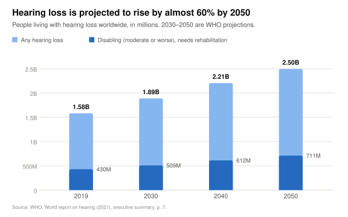
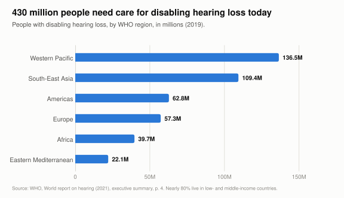
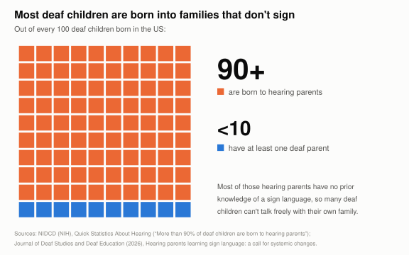
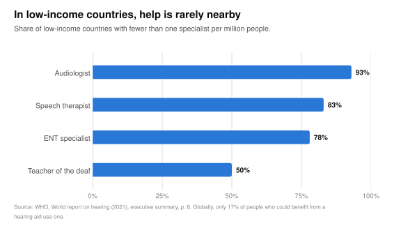
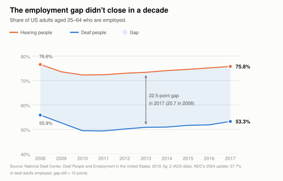
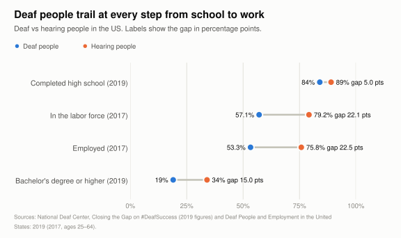
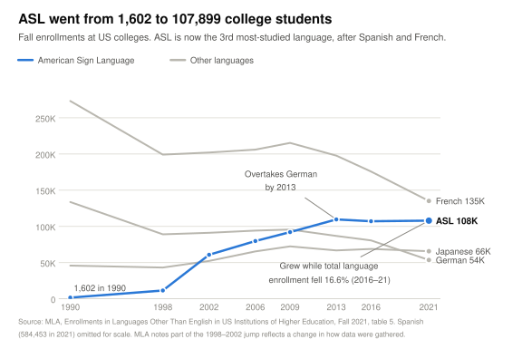
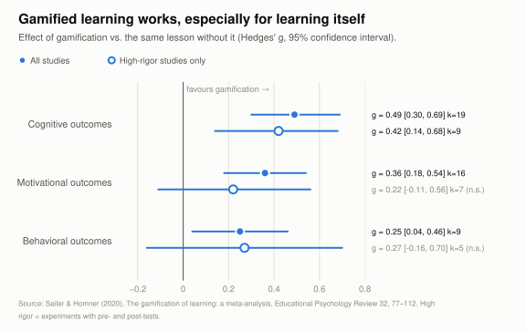

# Why CelestiSign matters: the evidence

Eight charts on the communication gap between deaf and hearing people, and on why a game is a
good way to start closing it. Every number comes from a primary source (WHO, NIH, the National
Deaf Center, the Modern Language Association, a peer-reviewed meta-analysis), which is cited
under each chart and listed with caveats at the end.

Each chart is in [`charts/`](charts/) as an SVG, with a 2×-resolution PNG copy for slides.

**Contents**

1. [Hearing loss is growing](#1-hearing-loss-is-growing)
2. [Where people need care](#2-where-people-need-care)
3. [The gap starts at home](#3-the-gap-starts-at-home)
4. [Help is scarce where it's needed most](#4-help-is-scarce-where-its-needed-most)
5. [The employment gap](#5-the-employment-gap)
6. [From school to work](#6-from-school-to-work)
7. [People want to learn ASL](#7-people-want-to-learn-asl)
8. [Games help people learn](#8-games-help-people-learn)

---

## The problem

### 1. Hearing loss is growing



By 2050, about **1 in 4 people** will have some hearing loss. The number who need care for
**disabling** hearing loss rises by 65%, from 430 million to 711 million.

<details><summary>Data table</summary>

| Year | Any hearing loss (millions) | Disabling (millions) |
|---|--:|--:|
| 2019 | 1,582 | 430 |
| 2030 | 1,889 | 509 |
| 2040 | 2,206 | 612 |
| 2050 | 2,497 | 711 |

[`data/hearing_loss_projection.csv`](data/hearing_loss_projection.csv)
</details>

### 2. Where people need care



Disabling hearing loss exists in every region. The Western Pacific and South-East Asia regions
together account for 57% of the total, and nearly 80% of affected people live in low- and
middle-income countries.

<details><summary>Data table</summary>

| WHO region | People (millions) |
|---|--:|
| Western Pacific | 136.5 |
| South-East Asia | 109.4 |
| Americas | 62.8 |
| Europe | 57.3 |
| Africa | 39.7 |
| Eastern Mediterranean | 22.1 |

[`data/disabling_hearing_loss_by_region.csv`](data/disabling_hearing_loss_by_region.csv)
</details>

### 3. The gap starts at home



**More than 9 in 10 deaf children** are born to hearing parents, and most of those parents
have no prior knowledge of a sign language. This is the gap CelestiSign is designed for: a
hearing family member can learn to fingerspell at home, for free, with a webcam.

### 4. Help is scarce where it's needed most



In **93% of low-income countries** there is less than one audiologist per million people.
Globally, only **17%** of people who could benefit from a hearing aid actually use one. When
professional care is out of reach, everyday communication with the people around you matters
even more.

<details><summary>Data table</summary>

| Specialist | Low-income countries with fewer than 1 per million | As reported by WHO |
|---|--:|---|
| Audiologist | 93% | "93% have fewer than one audiologist per million" |
| Speech therapist | 83% | "only 17% have one or more speech therapist per million" |
| ENT specialist | 78% | "approximately 78% have fewer than one ENT specialist per million" |
| Teacher of the deaf | 50% | "50% have one or more teacher for the deaf per million" |

Two rows are complements of what WHO reports (100% − 17%, and 100% − 50%), so that every bar
measures the same thing. [`data/specialist_shortage_low_income.csv`](data/specialist_shortage_low_income.csv)
</details>

---

## The cost

### 5. The employment gap



Over ten years the gap **widened**, from 20.7 to 22.5 percentage points. The National Deaf
Center's latest figures (2024 data) show deaf employment at a record 57.7%, but the gap is still
more than 15 points. Deaf people who work full time earn about the same as hearing people
($60,000 median for both in NDC's latest data), so the gap is in getting hired.

<details><summary>Data table</summary>

| Year | Deaf employed | Hearing employed | Gap (points) |
|---|--:|--:|--:|
| 2008 | 55.9% | 76.6% | 20.7 |
| 2009 | 52.7% | 73.6% | 20.9 |
| 2010 | 49.5% | 72.3% | 22.8 |
| 2011 | 49.4% | 72.4% | 23.0 |
| 2012 | 50.2% | 73.0% | 22.8 |
| 2013 | 50.9% | 73.4% | 22.5 |
| 2014 | 51.0% | 74.1% | 23.1 |
| 2015 | 51.7% | 74.6% | 22.9 |
| 2016 | 51.9% | 75.2% | 23.3 |
| 2017 | 53.3% | 75.8% | 22.5 |

[`data/us_employment_2008_2017.csv`](data/us_employment_2008_2017.csv)
</details>

### 6. From school to work



The gap is small at high school (5 points) and widens at each later step: 15 points for a
bachelor's degree and 22 points for being in work.

<details><summary>Data table</summary>

| Outcome | Year | Deaf | Hearing | Gap (points) |
|---|---|--:|--:|--:|
| Completed high school | 2019 | 84% | 89% | 5.0 |
| In the labor force | 2017 | 57.1% | 79.2% | 22.1 |
| Employed | 2017 | 53.3% | 75.8% | 22.5 |
| Bachelor's degree or higher | 2019 | 19% | 34% | 15.0 |

"In the labor force" is 100% minus the share NDC reports as *not* in the labor force (42.9% deaf,
20.8% hearing). [`data/us_deaf_hearing_outcomes.csv`](data/us_deaf_hearing_outcomes.csv)
</details>

---

## The opportunity

### 7. People want to learn ASL



ASL enrollments at US colleges grew **67-fold** in 30 years. Between 2016 and 2021, total
language enrollment fell by 16.6%, the steepest drop on record, and ASL was one of only three
of the top 15 languages that still grew. Demand is there. A free, playful first step can
reach people who never sign up for a class.

<details><summary>Data table</summary>

| Year | ASL | French | German | Japanese | All languages |
|---|--:|--:|--:|--:|--:|
| 1990 | 1,602 | 273,116 | 133,594 | 45,830 | 1,185,465 |
| 1998 | 11,420 | 199,064 | 89,013 | 43,141 | 1,186,632 |
| 2002 | 60,781 | 201,985 | 91,100 | 52,238 | 1,395,807 |
| 2006 | 79,744 | 206,019 | 94,146 | 65,410 | 1,575,838 |
| 2009 | 92,068 | 215,244 | 95,613 | 72,357 | 1,673,566 |
| 2013 | 109,567 | 197,679 | 86,782 | 66,771 | 1,561,176 |
| 2016 | 107,059 | 175,710 | 80,594 | 68,810 | 1,418,584 |
| 2021 | 107,899 | 135,088 | 53,543 | 65,661 | 1,182,562 |

[`data/us_college_language_enrollments.csv`](data/us_college_language_enrollments.csv)
</details>

### 8. Games help people learn



Across controlled studies, gamified lessons produced better **learning** (g = 0.49), more
**motivation** (g = 0.36) and more **engagement** (g = 0.25) than the same lessons without game
elements. The learning effect still holds when only the most rigorous experiments are counted
(g = 0.42). The motivation and engagement effects do not, which is shown honestly above.
CelestiSign's design leans on the strongest part of this evidence: you learn a letter by
producing it, get immediate feedback, and play against or alongside a real person.

<details><summary>Data table</summary>

| Outcome | Subset | Hedges' g | 95% CI | Studies (k) | Participants (N) |
|---|---|--:|---|--:|--:|
| Cognitive | All studies | 0.49 | 0.30 – 0.69 | 19 | 1,686 |
| Cognitive | High rigor only | 0.42 | 0.14 – 0.68 | 9 | 686 |
| Motivational | All studies | 0.36 | 0.18 – 0.54 | 16 | 2,246 |
| Motivational | High rigor only | 0.22 | −0.11 – 0.56 | 7 | 1,063 |
| Behavioral | All studies | 0.25 | 0.04 – 0.46 | 9 | 951 |
| Behavioral | High rigor only | 0.27 | −0.16 – 0.70 | 5 | 667 |

[`data/gamification_meta_analysis.csv`](data/gamification_meta_analysis.csv)
</details>

A closer precedent: **PopSign**, a smartphone bubble-shooter from RIT/NTID, Google and Georgia
Tech, uses sign recognition to teach ASL to hearing parents of deaf children. In a 20-person
study, practising by *producing* signs in the game was more efficient than a recognition-only
version.<sup>[9]</sup> CelestiSign is built on the same production-first idea.

---

## Sources

1. **WHO**, [*World report on hearing* (2021), executive summary](https://cdn.who.int/media/docs/default-source/documents/health-topics/deafness-and-hearing-loss/world-report-on-hearing/wrh-executive-summary2-en.pdf), pp. 4, 7, 8. Charts 1, 2 and 4. Current figures are confirmed in the [WHO fact sheet](https://www.who.int/news-room/fact-sheets/detail/deafness-and-hearing-loss) (March 2026).
2. **NIDCD (US National Institutes of Health)**, [*Quick Statistics About Hearing*](https://www.nidcd.nih.gov/health/statistics/quick-statistics-hearing). Chart 3.
3. [*Hearing parents learning sign language: a call for systemic changes*](https://cnlse.es/es/recursos/biblioteca/hearing-parents-learning-sign-language-a-call-for-systemic-changes), *Journal of Deaf Studies and Deaf Education* (2026). Chart 3: "most of whom have no prior knowledge of a sign language".
4. **National Deaf Center**, [*Deaf People and Employment in the United States: 2019*](https://nationaldeafcenter.org/wp-content/uploads/2019/10/Deaf-People-and-Employment-in-the-United-States_-2019-7.26.19ENGLISHWEB.pdf), fig. 2 and pp. 4–6 (American Community Survey 2017, ages 25–64). Charts 5 and 6.
5. **National Deaf Center**, [*Deaf Employment Reaches Historic High as Workforce Gaps Persist*](https://nationaldeafcenter.org/news-items/deaf-employment-reaches-historic-high-as-workforce-gaps-persist/) (March 2026; 2024 ACS). Chart 5 note.
6. **National Deaf Center**, [*Closing the Gap on #DeafSuccess*](https://nationaldeafcenter.org/news-items/closing-the-gap/). Chart 6 (high school and bachelor's figures).
7. **Modern Language Association**, [*Enrollments in Languages Other Than English in US Institutions of Higher Education, Fall 2021*](https://www.mla.org/content/download/191324/file/Enrollments-in-Languages-Other-Than-English-in-US-Institutions-of-Higher-Education-Fall-2021.pdf), tables 1a and 5. Chart 7.
8. **Sailer, M. & Homner, L.** (2020). [The gamification of learning: a meta-analysis](https://doi.org/10.1007/s10648-019-09498-w). *Educational Psychology Review*, 32, 77–112. Chart 8.
9. [*PopSignAI: Towards Using Sign Language Recognition Games to Improve ASL Learning in Novice Signers*](https://cnlse.es/es/recursos/biblioteca/popsignai-towards-using-sign-language-recognition-games-to-improve-american-sign-language-learning-in-novice-signers) (IUI 2026); [RIT news on PopSign](https://www.rit.edu/news/parents-deaf-children-can-more-easily-learn-sign-language-thanks-powerful-tech-collaboration).

### Caveats

- **Projections:** the 2030–2050 figures in chart 1 are WHO model projections, not
  measurements.
- **Mixed years:** chart 6 combines 2017 and 2019 figures from two NDC publications. Each row
  is labelled with its year.
- **Different methods:** the 2024 deaf employment figure (57.7%) comes from NDC's dashboard,
  which may use a different age range than the 2008–2017 series. It is quoted in the
  caption, not plotted on the same line.
- **Survey change:** MLA notes that part of ASL's 1998–2002 jump reflects a change in how
  data were gathered, so that step overstates real growth.
- **Course enrollments, not people:** MLA counts course enrollments, not individual students.
- **Small studies:** the meta-analysis pools 5–19 studies per outcome. The high-rigor
  subsets are small and have wide confidence intervals.
- **Deliberately left out:** a widely quoted Ghanaian study (48.5% of deaf participants
  reporting a misdiagnosis) comes from a single district with 167 participants. It is not
  charted, because it can't stand for a global rate.

## Regenerating the charts

The charts are generated from the CSVs in [`data/`](data/). Nothing in this folder is used by
the game.

```bash
cd impact
python3 -m venv .venv && .venv/bin/pip install -r requirements.txt
.venv/bin/python make_charts.py      # writes 16 files to charts/ (8 charts × SVG/PNG)
```

The colours are a palette checked for colour-blind safety, and are consistent across charts:
**blue is always deaf people** and **orange is always hearing people**.
